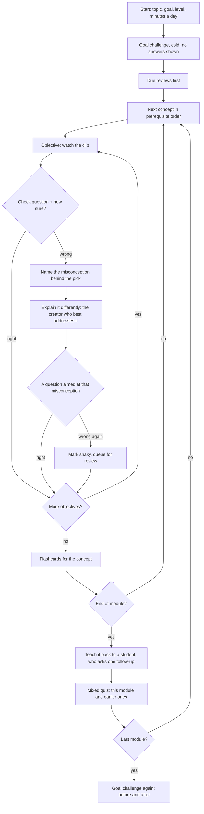

# Shifu: build plan

Meta Global AI Developer Hackathon. Written Tue 27 Oct 2026 (Sydney).
**Submission due Thu 5 Nov, 1:00 PM AEDT** (Wed 4 Nov, 9:00 PM ET).

## 1. What Shifu is

Type a topic. Shifu designs a structured course (modules → concepts → learning objectives), finds
the moment in a YouTube video that best teaches each objective, and plays those clips through the
official embed, interleaved with recall practice:

- a check question right after each clip;
- flashcards whose answer is the moment in the video;
- a "teach it back" step where the learner explains the idea aloud and is graded against what was said;
- a mind map that shows what they have mastered.

Missing a question plays a different creator's explanation of the same idea, then asks again.

**The problem, firsthand:** learners already learn from YouTube, but from scattered videos with no
structure, no order and no check that anything stuck. Search ranks videos, not explanations; nothing
tells you which 90 seconds of which video teaches the thing you are missing.

- **Theme:** Build for Your World.
- **Track:** Indie developer. Judged on
  creativity, technical ambition and whether it works; $400K of the prize pool. The demo should
  make the ambition visible (span verification, answerability checks, graded teach-back) and never
  break on camera.
- **Name:** working title. PlayShifu is an existing kids' edtech brand; check before a public launch.

## 2. Ground rules

From the participant guide, plus decisions taken in planning:

- **Everything is new.** Own stack, own infrastructure, own accounts. No code or services from
  Mixie, Interlocutor or ScoreFluent; borrowing their ideas is fine.
- **Public repo from day 1:** https://github.com/rishulmatta/shifu. Commit as work lands and push
  at every milestone (the "Done when" column in §10). The history is the evidence of what was built
  during the hackathon.
- **Meta's models do the real work.** Judging stage 1 is a pass/fail on this.
- **Never download video or audio from YouTube.** Captions (text with timestamps) come from a hosted
  transcript API; playback is the official IFrame embed only.
- **Caption text is never shown verbatim.** It is used to find and understand spans. Every clip
  credits the channel and links to the video.
- **No chatbot UI.** The anti-project list names "simple AI for Education chatbots". Shifu is a
  course with a player, not a chat window.
- **Demo video:** 3 minutes, showing only what was built during the hackathon (all of Shifu).
- **Muse Code has a small, real role.** The rules don't require it: judging stage 1 checks that the
  *project* uses Meta Model API or Meta's open-weight models. It does show Meta's tools in use. Muse Code pressure-tests
  this plan and builds two small modules (§4, "Who builds what"). Each agent commits its own work
  as it goes, and the README says exactly what Muse Code did.

## 3. The learner's path

The order in which a learner takes a course, and what happens at each step. Progress and mastery
are in §7.

**Starting.** Topic, goal ("pass my stats exam", "understand transformers for work"), level and
minutes per day. The outline and mind map appear in about 15 s and module 1 is ready in 1–2 min;
later modules build in the background.

**Order.** Concepts follow the prerequisite graph from the plan: modules in order, and inside a
module a concept comes only after the concepts it builds on. The default next step is the first
unfinished concept whose prerequisites are done. The mind map lets the learner jump anywhere;
jumping past an unfinished prerequisite names it and offers to go there first, but never blocks.

**A session** fits the learner's minutes per day:

1. Due reviews first, at most a quarter of the time, mixing earlier concepts.
2. New material, from the exact block where the learner stopped.
3. A short summary: what was learned, what was re-explained, what comes up for review and when.

**A concept** is one round per objective:

1. Why it matters: one line from the plan, and the earlier concept it builds on.
2. For each objective, the clip and then a check question straight away.
   - Right: on to the next objective.
   - Wrong: "Explain it differently" plays the same idea from a different creator, then asks a new
     question on that objective.
   - Wrong again: the objective is marked shaky and queued for review, and the course moves on
     rather than trapping the learner.
3. Flashcards for the concept, rated once (again, hard, good, easy) to seed the scheduler.

**A module** ends with:

1. Teach it back: explain the module's main idea aloud in up to 90 s, then see what was covered,
   missed or misunderstood, each with a rewatch button on the exact clip.
2. A mixed quiz: questions from this module plus one or two from earlier modules.

**The goal challenge** opens and closes the course (see "Teaching that works" below): 3–5
challenges at the level of the learner's goal, tried cold before module 1 and again at the end.
The cold attempt doubles as placement: a concept whose challenges were answered right gets a
"you may know this already" note, and its clips can be skipped straight to the check question.

**Finishing.** A course is complete when every concept has been studied and every module's
teach-back done. It is mastered when every objective is solid.



### Teaching that works

Questions, flashcards and a mind map are the ingredients. These five decide when they're used and
what Shifu reacts to. Each rests on a well-replicated finding, and each is something a playlist
can't do. (Decided 27 Oct; "pause and predict" was considered and dropped.)

1. **The goal challenge, before and after.** From the goal ("pass my stats exam"), Shifu writes
   3–5 scenario questions that apply several objectives at once: what the learner came for, not
   recall of one clip. Each names the objectives it draws on.
   - **Cold, before module 1:** an "I don't know yet" option on each, and no answers shown, so
     nothing is given away for the end.
   - **Again at the end:** now with feedback, the misconception behind each wrong pick and a
     rewatch link for each objective involved. The result is the headline: "Before: 1 of 5. Now:
     4 of 5."
   - Written right after the plan, in parallel with module 1, and kept only if a blind second
     answer agrees with the key and finds no other defensible option. They aren't tied to a clip,
     so there is no quote check; the README says so.
2. **Wrong answers that diagnose.** Every distractor stands for a named misconception ("this mixes
   up P(A|B) with P(B|A)"), stored with the question. A wrong pick shows it. Then "explain it
   differently" goes to the server with that misconception: Muse Spark picks the alternate clip
   that best addresses it and writes a question aimed at it, with the same quote and answer-blind
   checks. The request starts the moment the learner answers, so it is usually ready by the time
   they click. If it fails or there are no captions, the pre-built alternate question is used.
3. **How sure are you?** The learner picks an answer, then taps Guessing, Think so or Sure to lock
   it in. Confident errors are the ones learners correct best once told (the hypercorrection
   effect), so they get their own treatment:
   - sure and wrong: called out, and the objective goes straight to shaky (to the front of the
     review queue) instead of waiting for a second miss;
   - right but guessing: counts as progress, not as the unaided correct answer that solid needs;
   - the progress tracker shows calibration ("when you were sure, you were right 8 of 10 times")
     and lists the surprises.
4. **You become the shifu.** The teach-back is to a curious student. After the explanation, the
   student asks one follow-up question aimed at the biggest gap (or, if nothing is missing, a
   "why" or "what if" that goes deeper), also told about misconceptions the learner showed earlier
   in the module. The learner answers by voice or text; the answer is graded on that objective and
   counts as teach-back evidence. Then the full report: covered, missing, not quite right, with
   rewatch links. One question, one answer: it is not a chat.
5. **Examples from your world.** The planner pulls the learner's context out of the goal ("my
   marketing job", "a stats exam"). The quiz question for each objective (the second question from
   its clip) is set in that world when it fits: near transfer after the clip, far transfer in the
   quiz. The goal challenges use it too.

### The course coach

Asked for on 28 Oct: the learner can tell Shifu what they need and the course changes to fit
("ask me more questions", "explain the basics first"). It is not a chatbot: the coach never
teaches in the chat, and every reply comes with one visible change to the course.

- **Practice:** more check questions on the objectives they're on or weakest in, written from the
  objective's clips with the same quote and answer-blind checks, placed next.
- **A prerequisite:** a new concept the current one builds on (title, why, one or two objectives,
  YouTube searches), built from fresh clips through the same steps as a course build. Its node
  grows into the mind map while it builds; it is placed before the concept that needs it, and the
  learner can start it at once.
- **Explain it differently**, **go to** a concept the course has, or **skip ahead**: done in the
  browser.
- **None:** a short reply for anything else, saying what the coach can do.

Muse Spark 1.3 picks the change (low effort, about 5 s), reading the whole course with the
learner's states, where they are and their recent misconceptions. The server checks that it names
real objectives and playable concepts, and makes a smaller change or none rather than a wrong one.
Changes are the learner's own: they live with their progress in the browser and are merged into
the course for the player and the map, so one learner's coaching doesn't reshape the course for
everyone with the link. Limits: 40 messages and 6 new concepts per visitor per hour, 60 new
concepts a day in all.

## 4. Architecture

```
browser: course player, mind map, recorder
   │
Next.js 16 on Vercel: route handlers and server actions
   ├─ build workflow (durable steps, progress streamed to the UI)
   │    plan → discover → transcripts → locate → verify → merge → recall → assemble
   ├─ model router: task → (provider, model), with fallback
   │    Meta Model API: Muse Spark 1.3, Muse Voice Transcribe (stretch: Muse Image, SAM 3.1)
   │    Baseten: Muse Spark Open (meta-models/muse-spark-open-1026)
   ├─ YouTube Data API v3: search, metadata, embeddable flag
   └─ hosted transcript API: captions with timestamps
   │
Postgres (new): courses, transcript cache, spans, recall items, learner state
```

**Stack:** Next.js 16 (App Router), React 19, TypeScript strict, Postgres via `pg` on a new
project, a new Vercel project, Vercel Workflow for the build pipeline (`after()` locally), zod for
every model output, `ts-fsrs` for scheduling, hand-drawn SVG for the mind map (no graph library), the YouTube IFrame
API for playback.

**No accounts for the hackathon.** An anonymous learner id lives in a cookie and courses have
shareable URLs, so judges can open the live app and start learning without signing up. Credits are
protected by per-IP rate limits and a global daily cap on new course builds; pre-built demo courses
open instantly.

**Interfaces that leave room for later sources:**

- `VideoSource { search, metadata, transcript, embed }`: `youtube` now; `meta-creator`
  (an educator's own Facebook/Instagram videos) as a stretch goal.
- `ModelRouter.run(task, input)`: every model call goes through it, so a task can move to another
  provider when credits or rate limits run out.

### Who builds what

| Agent | Does |
|---|---|
| Muse Code | **Day 1:** reviews this plan with its `/plan` and `/grilling` skills; the useful changes are folded in here. **Days 2–4:** builds a small, self-contained module: the FSRS scheduling module (a `ts-fsrs` wrapper) with its tests. The mind map was its other task; Claude Code built it on 28 Oct so it could anchor the demo |
| Claude Code | everything else |

- **Contract first.** On day 2, fix the shared types (course, concept, objective, span, recall
  item, timeline block, mastery) and seed one fixture course, so Muse Code's modules are built
  against the same shapes the pipeline produces.
- **Muse Code works on its own branch**, merged when each task is done. This needs git by day 2.
- Point Muse Code at this file in its first prompt; whether it reads an instruction file such as
  `AGENTS.md` is not documented on its landing page.

## 5. Where each Meta model works

| Task | Model | API | Why |
|---|---|---|---|
| Plan the course: modules, concepts, prerequisite graph (the mind map), objectives, search queries, must-include points per objective | Muse Spark 1.3 | Meta Model API | reasoning and structured output; one call per course |
| Locate the span that teaches each objective in each candidate transcript | Muse Spark Open | Baseten | the fan-out: hundreds of calls per course |
| Merge: best span per objective across videos, plus alternates | Muse Spark 1.3 | Meta Model API | one call per concept; judgment |
| Recall items per clip: check questions, flashcards, cloze cards | Muse Spark Open | Baseten | fan-out |
| Answerability check: answer each question from the clip without the key | Muse Spark Open | Baseten | an independent check (§6, step 7) |
| Transcribe the learner's teach-back | Muse Voice Transcribe, else Muse Spark Open | Meta Model API, else Baseten or Modal | file endpoint; Muse Spark Open takes audio input too |
| Grade the teach-back against the objectives and clips | Muse Spark 1.3 | Meta Model API | judgment with citations |
| Stretch: diagram flashcards (draw a labelled diagram, mask its labels) | Muse Image → SAM 3.1 | Meta Model API | the image is generated, so there is no rights issue |

**Limits and prices** (Meta's pricing page, 27 Oct): Muse Spark 1.3 allows 3,000 requests and 4M
tokens a minute, at $1.25 in and $4.25 out per million tokens. A course of about 1M input and 0.15M
output tokens therefore costs about $2, so $150 covers roughly 75 courses; the daily build cap
protects it. The `-contributor` variants cost $0.10 / $0.20 but Meta uses the inputs to improve its
products, and here the inputs would be other creators' captions, so the standard variant is the
default. Muse Voice Transcribe costs $0.18 an hour of audio and takes WAV only, at most 10 minutes
and 32 MB per file.

**Baseten** (credits granted 27 Oct): $100 and up to 2M tokens a minute. The key only works with
`meta-models/muse-spark-open-1026`. Same price per token as Muse Spark 1.3 on Meta ($1.25 in, $4.25
out per million). The model always reasons, reasoning tokens count as output, and at the default
effort they dominate it, so every task sets `reasoning_effort` (§6, step 4). Tested 27 Oct:
`json_schema` output works, and the reasoning comes back in a separate `reasoning_content` field.

**Meta Model API** ($150 credit, key live 28 Oct): Muse Spark 1.3 plans a full course as
schema-checked JSON in about 24 s for $0.027, most of it reasoning. It takes `reasoning_effort`
from `minimal` to `max` but rejects `none`.

**Modal** ($100 credit, endpoint live 28 Oct): a Shared Endpoint serves the same weights
(`meta-models/Muse-Spark-Open-816B-A42B`) per token at the same price. Tested: `json_schema`
output, audio input, and `reasoning_effort` `low` to `xhigh` only; it reports reasoning tokens at
the top level of `usage`. Every Muse Spark Open task tries Baseten first, then Modal, then Muse
Spark 1.3 on Meta Model API (the order in `config.ts`); each provider lists the efforts it accepts
and the router rounds a rung's effort up to one of them. Modal's docs say the credits included
with a plan don't pay for Shared Endpoint usage, so check that the hackathon credit does before
relying on it. Self-hosting is out: the model needs four to eight Blackwell GPUs.

**Speech** (tested 28 Oct, 20 runs each on two recordings): Muse Voice Transcribe always had every
word and nothing else, in 4–7 s, but stutters ("the the", "doesn't really doesn't really") in
most runs, which `collapseStutters` removes; it hears "Bayes" as "base". Muse Spark Open, which
takes audio input, is the fallback: verbatim in 2–7 s, but about half its runs echo the last
sentence (`trimEcho` cuts that) and about one in ten says "(silence)", drops the recording, doubles
a sentence or adds one nobody said ("This transcript was generated automatically…"). Telling it
the topic made it write the topic in as if spoken, so it gets no hint. The test recordings are
synthesised (`say`); a real voice in the browser is still to check.

## 6. The build pipeline

Each step is a durable, idempotent workflow step that writes progress for the UI.

1. **Plan** (Muse Spark 1.3, structured output). Input: topic, goal, level, time budget. Output:
   3–5 modules of 3–5 concepts each; prerequisite edges; 1–3 objectives per concept, phrased as
   things the learner can do ("compute a posterior from a prior and a likelihood"); 2–3 search
   queries per concept; for each objective, the 2–4 points a good explanation must include; the
   learner's context from the goal ("a stats exam", "my marketing job"). Total watch time fits the
   learner's budget.

   **1b. Goal challenges** (Muse Spark, in parallel with module 1): 3–5 scenario questions at the
   level of the goal, each naming the objectives it draws on and a misconception per distractor;
   kept only if a blind second answer agrees with the key and finds no other defensible option.

2. **Discover** (YouTube Data API). Per concept: `search.list` (`type=video`,
   `videoEmbeddable=true`, `relevanceLanguage`, `safeSearch=strict`), then `videos.list` for
   duration, caption flag and statistics. Keep 3–40 min videos; rank by relevance, views, channel
   and recency; keep 5–8 per concept.
   **Quota:** `search.list` costs 100 of the default 10,000 units a day, so about 100 searches a day
   (roughly 8 new courses). Cache searches by query, search once per concept rather than per
   objective, and apply for a quota increase on day 1. SearchAPI (the transcript vendor below) also
   offers YouTube search on the same key, which removes that limit; `videos.list` (1 unit) still
   checks embeddable and duration.

3. **Transcripts** (hosted API: SearchAPI's `youtube_transcripts` engine, with Supadata in
   `mode=native` as the runner-up; see §13). Timestamps come per caption line (`start`,
   `duration`), not per word, which is fine for clip boundaries. Fetch in parallel, cache forever by
   video id, drop videos without captions, and check the language that comes back (an auto track
   can come back machine-translated).

4. **Locate** (Muse Spark Open, fan-out). One call per unique video: a video found for several
   concepts gets all of their objectives in one call. Input: the objectives with their must-include
   points, and the transcript as numbered, timed lines (`L42 [12:31] …`). Output per objective: at
   most one span `{firstLine, lastLine, covers[], selfContained, quote}`, or none; code turns line
   numbers into seconds. Volume: a 30-min transcript is about 7K tokens, so 12 concepts × 6 videos
   is about 0.5M input tokens per course.
   - **Tested 27 Oct** on a six-line transcript: asked for an end *timestamp*, the model cut the
     explanation short at low effort; asked for line numbers, it ended on the right line in every
     run at every effort. The start still varied (from the intro line to a "That's…" line), which
     is what step 5 and the day-3 eval are for. One run returned two overlapping spans, hence "at
     most one".
   - **Reasoning effort:** start at `none` (1.7 s and about 300 reasoning tokens on the test, against
     7.5 s and 2,100 at the default) and raise it only where the day-3 eval shows a need.

5. **Verify** (deterministic code, no model).
   - Snap boundaries to caption-line edges and clamp each span to 30–240 s.
   - The span's `quote` must fuzzy-match transcript text inside the span, or the span is dropped.
   - Flag openings that lean on earlier context ("as we saw", "this one here"): pull the start
     back to where that context begins, or mark the span not self-contained.

6. **Merge** (Muse Spark 1.3). Per concept: the best span per objective, plus up to 2 alternates
   from different creators (the "explain it differently" pool). Prefer self-contained spans that
   cover every must-include point, fit the time budget and vary the creators.

7. **Recall** (Muse Spark Open, fan-out per chosen span). 2–3 check questions (multiple choice with
   plausible distractors, or short answer) and 2–4 flashcards (basic or cloze), each with evidence
   `{spanId, quote}`. Every distractor carries the misconception it stands for, shown when it's
   picked. The quiz question is set in the learner's context when it fits. Two checks:
   - **Quote check:** the quote must be in the span's transcript text, or the item is dropped.
   - **Answerability check:** a separate call answers the question from the span text alone,
     without the key. If it disagrees with the key or picks a distractor, drop the item and
     regenerate once.

   This is the "verifiable agents" story (the Agents 102 workshop covers it).

8. **Assemble.** Write the course timeline: per concept, its clips in objective order with a check
   after each objective and flashcards at the end; a teach-back at the end of each module.

Module 1 runs through every step first so the learner can start; the rest follows in the background.

## 7. Mastery and the progress tracker

**Mastery per objective**, from evidence:

| State | Reached when |
|---|---|
| new | no attempt yet |
| learning | attempted, but not yet solid or shaky |
| shaky | missed twice in a row, marked missing or misunderstood in a teach-back, or forgotten in a review (rated "again") |
| solid | answered correctly the first time **and** confirmed later: covered in a teach-back, or passed a spaced review |

- The latest evidence wins: a solid objective forgotten in review drops to shaky, and a shaky one
  answered correctly rises to learning.
- A concept's state is its weakest objective's.
- The rules are one pure, unit-tested function, `nextState(state, event)`.
- Why solid needs two pieces of evidence: a right answer straight after a clip shows short-term
  understanding; recalling it later, or in your own words, shows it stuck. Teach-back counts, so a
  learner can reach solid in one sitting, and so can the demo.

**The progress tracker**, on the course page and in a "Today" panel:

- **Course progress:** concepts studied out of the total, per module and overall, and minutes
  watched out of the course's length.
- **Mastery:** the course's objectives as a stacked bar (new, learning, shaky, solid). On the mind
  map each concept is a node whose ring has one segment per objective, coloured by state.
- **Today:** reviews due and their estimated minutes, then "Continue: <concept>" at the exact block
  where the learner stopped.
- **Session summary:** learned, re-explained, shaky, and the next review date.
- **Teach-back history:** per module, the points covered and missed on each attempt.
- **Should:** a streak (days with a session), and a "continue on another device" link, since
  progress is tied to the browser's cookie while there are no accounts.

**Mechanics:**

- **A miss** names the misconception behind the pick, then plays the alternate span that best
  addresses it and asks a question aimed at it, written on demand (`/api/courses/[slug]/retry`);
  the pre-built alternate question is the fallback.
- **Confidence:** every check and quiz answer carries Guessing, Think so or Sure. Sure and wrong
  is a lapse (shaky at once); a correct guess is progress but not the unaided correct answer.
- **Teach-back:** browser recorder → WAV encoded in the browser (16 kHz mono; the API takes WAV
  only) → upload → Muse Voice Transcribe (`POST /asr/transcribe`, `PUSH_TO_TALK`), stutters
  collapsed, or Muse Spark Open listening to the WAV when there is no Meta key or it fails →
  grader returns
  `{covered[], missing[], misconceptions[]}`, each tied to an objective and a span. Missing points
  become review items and offer "rewatch" on the exact clip.
- **Review:** `ts-fsrs` schedules flashcards and objective checks; a review session interleaves
  concepts.

## 8. Data model (first cut)

| Table | Holds |
|---|---|
| `courses` | topic, goal, level, budget, status, plan JSON, share slug |
| `concepts`, `concept_edges` | modules and concepts, prerequisite graph |
| `objectives` | per concept, with must-include points |
| `videos` | YouTube metadata cache |
| `transcripts` | timed lines per video, cached forever |
| `spans` | objective, video, start, end, rank (chosen or alternate), verification result |
| `recall_items` | type, prompt, answer, distractors, evidence, check results |
| `learners` | anonymous id |
| `enrollments` | learner × course: minutes per day, current position (concept, block), started, completed |
| `objective_states` | learner × objective: state, evidence counts, last event (written by `nextState`) |
| `sessions` | learner × course: start, end, minutes, blocks done (for the summary and the streak) |
| `attempts` | learner × item: answer, correct, time taken |
| `teachbacks` | learner × module: audio reference, transcript, grading JSON |
| `reviews` | learner × item: FSRS state |
| `build_jobs` | course × step: progress, tokens, cost, errors |

**Decision (27 Oct): learner state lives in the browser for the hackathon.** Without accounts,
progress is tied to one browser anyway, so `learners`, `enrollments`, `objective_states`,
`attempts`, `reviews` and `sessions` are kept in `localStorage` (`src/lib/learner.ts`) rather than
Postgres. Postgres holds course content: courses, concepts, objectives, videos, transcripts, spans,
recall items and build jobs. The "continue on another device" link (Should) would move this
server-side.

## 9. Scope

**Must (the demo depends on it)**

- The whole build pipeline: plan, discover, transcripts, locate, verify, merge, recall, assemble.
- Course player: clips through the embed, check questions between them, "explain it differently"
  on a miss.
- Teach-back by voice, graded, with clip links.
- Flashcards.
- The learner's path (§3): prerequisite order, the per-objective loop, the end-of-module teach-back
  and mixed quiz.
- Progress tracker (§7): course progress, mastery bar, resume at the exact block, the Today panel.
- Mind map with per-objective mastery rings (built 28 Oct).
- The course coach (§3, asked for on 28 Oct): practice and prerequisites on request.
- Teaching that works (§3), in this order: the goal challenge before and after, the student's
  follow-up in the teach-back, wrong answers that diagnose, confidence, examples from the
  learner's world.
- Live deployment with 3 pre-built demo courses.

**Should**

- FSRS review queue.
- Session summary.
- Live build progress in the UI.

**Cut (27 Oct, to make room for "Teaching that works")**

- Streak and the "continue on another device" link.
- Stretch: creator import from Facebook and Instagram, and diagram flashcards (Muse Image and SAM).

## 10. Schedule

Dates are Sydney time (AEDT). Live sessions are at 12:00 PM ET, which is 3:00 AM here: watch live
or catch the recording if one is posted. Office hours (Discord, text only) are weekdays 10–11 AM ET:
1–2 AM AEDT until 1 Nov, then 2–3 AM after US clocks change.

| Day | Date | Build | Done when |
|---|---|---|---|
| 1 | Tue 27 Oct | Accounts and keys (Meta Model API, YouTube Data API, transcript vendor, Vercel, Postgres); request partner credits; Muse Code reviews this plan; Next.js skeleton. **Spikes:** Muse Spark 1.3 structured output; one Baseten call; transcript vendor on 10 videos; Muse Voice Transcribe on a browser recording (check accepted audio formats) | every spike returns real output; vendor chosen |
| 2 | Wed 28 Oct | Shared types (including mastery states and progress) and a fixture course; model router; plan step; discover and transcripts with caching; schema and migrations | topic → outline plus candidate videos with transcripts in the database; Muse Code started on its two modules |
| 3 | Thu 29 Oct | Locate (fan-out), verify, merge. Eval: hand-pick the best span for 10 objectives across the 3 demo topics and compare | at least 7 of 10 chosen spans acceptable |
| 4 | Fri 30 Oct | Course player (timeline, embed with start and end, check blocks); recall generation with both checks; merge Muse Code's two modules | one full module playable end to end |
| 5 | Sat 31 Oct | The learner's path: answers, "explain it differently", `nextState` with tests, the progress tracker and resume; wire Muse Code's mind map to real mastery | a missed question plays a different creator, and progress survives a reload |
| 6 | Sun 1 Nov | Teach-back: recorder, transcription, grading UI; flashcards | a spoken explanation is graded with rewatch links |
| 7 | Mon 2 Nov | Deploy; rate limits and daily cap; pre-build the 3 demo courses; review queue on Muse Code's FSRS module and the Today panel; fix what the demo courses expose | the live URL works for a stranger with no sign-up |
| 8 | Tue 3 Nov | Feature freeze (stretch work only if everything above is solid); README, including exactly what Muse Code did; demo script. Last day of organiser support: Tue 3 Nov ET, which runs to about 4 PM Wed 4 Nov AEDT | README done; video script locked |
| 9 | Wed 4 Nov | Record and edit the 3-minute video; final fixes; make the repo public; draft the submission | video uploaded and its link checked |
| 10 | Thu 5 Nov | **Submit by 10:00 AM AEDT**, three hours before the 1:00 PM deadline | submitted; repo public; video plays when logged out |

## 11. Demo video (3:00)

| Time | Shows |
|---|---|
| 0:00–0:20 | The problem: 40 videos on one topic, no structure, no idea what stuck |
| 0:20–0:40 | Type a topic and a goal → outline appears; the goal challenge, cold: 1 of 5 |
| 0:40–1:25 | Learn: clip → "Sure" → wrong → Shifu names the misconception → the creator who best addresses it → a question aimed at it → right |
| 1:25–2:05 | Teach it back by voice → the student asks about the gap → answer → covered, with rewatch links for the rest |
| 2:05–2:30 | The goal challenge again: "Before: 1 of 5. Now: 4 of 5." Mind map rings, calibration |
| 2:30–3:00 | How it works: which Meta model does what, the verification checks, built in 9 days |

## 12. Risks

| Risk | Plan |
|---|---|
| YouTube search quota (about 100 searches a day) | cache; one search per concept; pre-built demo courses; quota increase requested on day 1 |
| Transcript vendor fails or is slow | 10-video test on day 1; `transcript()` stays swappable; cache everything |
| Baseten credits run out | router falls back to Muse Spark Open on Modal, then Muse Spark 1.3 on Meta Model API; spend tracked per course in `build_jobs` |
| Meta credits link late; a card is required | add a card with a spend limit as soon as the link opens |
| Course build too slow | module 1 first; streamed progress; pre-built demo courses |
| Poor span choices | the day-3 eval; verification drops bad spans; alternates cover gaps |
| Muse Spark Open's structured output on Baseten | validate with zod; retry once with the error |
| Rights | captions only, never media; caption text never shown; every clip credited and linked |
| Looks like an "education chatbot" | the coach changes the course instead of chatting: it never teaches in the chat and every reply makes one visible change (practice up next, a new concept growing into the mind map); the demo leads with the course and the verification |

## 13. Open decisions

- **Judging rubric and prize tables:** they did not survive the paste of the participant guide.
  Paste them in to check the demo against the Indie criteria.
- **Team:** solo, or up to 4 (the Indie track is described as "for individual builders and students").
- **Transcript vendor:** SearchAPI recommended (compared 27 Oct, vendor pages only, nothing tested
  live): choice of auto or manual captions, 100 free requests then $40 for 10,000, only successful
  requests billed, an SLA and a status page, no AI transcription that could run up charges, and
  YouTube search on the same key. Runner-up: Supadata ($17 for 3,000), always with `mode=native`,
  because its default transcribes caption-less videos with AI and bills per minute.
- **Postgres host:** Railway (familiar) or Neon from the Vercel Marketplace.
- **The 3 demo topics.** Proposal: Bayes' theorem, attention in transformers, chord progressions in
  music theory. They cover visual, verbal and auditory teaching, and none is near the anti-project list.

## 14. Do today

- [x] Request Modal credits (first 1,000 people) and Baseten credits (Appendix A). Both granted: Baseten 27 Oct, Modal 28 Oct.
- [ ] Claim the $150 Meta Model API credits when the link opens; add a card and a spend limit.
- [ ] Join the Discord and post in #intros.
- [ ] New Google Cloud project → YouTube Data API key; apply for a quota increase.
- [ ] Choose the transcript vendor.
- [ ] Install Muse Code (`curl -fsSL https://dev.meta.ai/install.sh | bash`) and pick a plan. The
      $5 Everyday plan (10–50 prompts per 5 hours) is probably enough for a plan review and two
      small modules. Ask in #office-hours whether the $150 Meta Model API credits cover Muse Code;
      its page doesn't say.

## Appendix A: Baseten credit request

**What are you building and how will you use Baseten?**

> I'm building Shifu: type a topic and it designs a structured course (modules, concepts, learning
> objectives), then finds the moment in a YouTube video that best teaches each objective and plays
> those clips through the official embed, mixed in with recall practice: check questions right
> after each clip, flashcards whose answer is the moment in the video, and a "teach it back" step
> where the student explains the idea aloud and is graded against what was said. Missed items go
> into spaced repetition and pull a different video's explanation of the same idea.
>
> I'll run Muse Spark Open (`meta-models/muse-spark-open-1026`) on Baseten for the high-volume
> work: reading every candidate video's timestamped transcript for each concept to find the span
> that teaches each objective, then writing recall items for every clip and checking each one by
> having the model answer it from the clip alone. One course fans out into hundreds of parallel
> calls across concepts and candidate videos, which is why I need the 2M TPM limit. Meta Model API
> handles course planning, grading and speech transcription.

## Appendix B: Hackathon reference

- Event: https://cerebralvalley.ai/e/meta-ai-developer-hackathon
- Discord: https://cerebralvalley.ai/e/meta-ai-developer-hackathon/discord
- Live stream: https://cerebralvalley.ai/e/meta-ai-developer-hackathon/live
- Submit: https://cerebralvalley.ai/e/meta-ai-developer-hackathon/hackathon/submit
- Meta docs: https://dev.meta.ai/docs/overview · models: https://dev.meta.ai/docs/models ·
  video input: https://dev.meta.ai/docs/video-understanding
- Cookbooks: https://github.com/meta-models/meta-model-cookbook ·
  https://github.com/meta-models/meta-oss-cookbook
- Baseten credits form: https://docs.google.com/forms/d/e/1FAIpQLSfM7gcK8yMZEmAGq6DbTyiuv2c71IH7CKCy0fXGIfUED1qxVQ/viewform
- Modal credits form: https://docs.google.com/forms/d/e/1FAIpQLSe_GDPtLZsdA57xPhFcOCi_yLjPf8HRxMIQJ5V7ystoKSqWCQ/viewform
- Fireworks credits form: https://docs.google.com/forms/d/e/1FAIpQLSdPQTTES8_nhavzZkOrebVNYbM1FumWLdpeZx8ZSNe4QLXKPA/viewform

**Submission checklist:** public repo; 3-minute demo video showing only hackathon-built features;
everyone who worked on it listed; one representative submits for the team.

**Judging:** stage 1 pass/fail (fits a theme, uses Meta's models); stage 2 scores 0–10 on equally
weighted criteria; stage 3 the top 5 per track are ranked by judges watching the videos live.
Finals and winners: Mon 9 Nov 12:00 PM ET (Tue 10 Nov, 4:00 AM AEDT).
