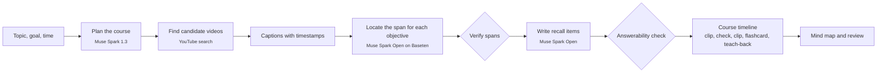
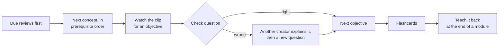

<p align="center">
  <picture>
    <source media="(prefers-color-scheme: dark)" srcset="public/brand/shifu-mark-dark.svg">
    
  </picture>
</p>

<h1 align="center">Shifu</h1>

<p align="center">
  <strong>Any topic, taught by the best moments on YouTube, and checked until it sticks.</strong>
</p>

<p align="center">
  <a href="https://cerebralvalley.ai/e/meta-ai-developer-hackathon"></a>
  
  
  
  
</p>

<br>

Learners already learn from YouTube, but from scattered videos with no structure, no order and no
check that anything stuck. Search ranks videos, not explanations: nothing tells you which ninety
seconds of which video teaches the thing you are missing.

**Shifu** (師父, Mandarin for *master* or *teacher*) turns a topic into a structured course, finds
the moment in a YouTube video that best teaches each learning objective, and plays those clips in
order with recall practice woven in.

<table>
  <tr>
    <td width="50%" valign="top"><strong>A course, not a playlist</strong><br>Modules, concepts and learning objectives, designed around your goal and the time you have.</td>
    <td width="50%" valign="top"><strong>The right ninety seconds</strong><br>Each objective is matched to the span of a video that teaches it, played through the official YouTube embed.</td>
  </tr>
  <tr>
    <td valign="top"><strong>Recall woven in</strong><br>A check question after each clip, flashcards whose answer is the moment in the video, and spaced review.</td>
    <td valign="top"><strong>Explain it differently</strong><br>Miss a question and a different creator explains the same idea before Shifu asks again.</td>
  </tr>
  <tr>
    <td valign="top"><strong>Teach it back</strong><br>Explain the idea aloud. Shifu shows what you covered and what you missed, and plays the moment that fills the gap.</td>
    <td valign="top"><strong>A mind map that fills in</strong><br>Concepts and their prerequisites, each ringed by how well you know its objectives.</td>
  </tr>
  <tr>
    <td valign="top"><strong>A path that respects prerequisites</strong><br>Concepts come in the order they build on each other, and every session starts with what is due for review.</td>
    <td valign="top"><strong>Progress that means something</strong><br>An objective counts as solid only when you get it right and it holds up later, in review or in your own words.</td>
  </tr>
  <tr>
    <td valign="top" colspan="2"><strong>A coach that reshapes the course</strong><br>Say "ask me more questions" or "explain the basics first" and the course changes: checked practice questions come next, or a new prerequisite concept is built from fresh clips and grows into your mind map. The coach never lectures in a chat; every reply is a change you can see.</td>
  </tr>
</table>

## How it works



## A learner's path



Each objective moves from *new* to *learning* to *solid*, or to *shaky* when it slips. The details
are in [`PLAN.md`](PLAN.md) §3 and §7.

## Meta's models at work

| Job | Model | Where |
|---|---|---|
| Design the course: modules, concepts, objectives and the prerequisite graph behind the mind map | Muse Spark 1.3 | Meta Model API |
| Read every candidate video's captions and find the span that teaches each objective | Muse Spark Open | Baseten, then Modal |
| Write check questions and flashcards for every clip, then answer each one from the clip alone as a check | Muse Spark Open | Baseten, then Modal |
| Transcribe the learner's spoken explanation | Muse Voice Transcribe, with Muse Spark Open listening to the audio as the fallback | Meta Model API, Baseten or Modal |
| Grade the explanation against the objectives and the clips | Muse Spark 1.3 | Meta Model API |

## Why you can trust a clip or a question

- **Every span is quoted.** A chosen span carries a quote that must appear in the captions inside the span, or the span is dropped.
- **No clips that start mid-thought.** Spans that lean on earlier context ("as we saw…") are extended back to where that context begins, or marked as not self-contained.
- **Every question is answered blind.** A separate model call answers each question from the clip alone, without the key. Questions it cannot answer correctly are thrown away.
- **Feedback points at the fix.** Each missing point in a teach-back is tied to an objective and to the clip that explains it.

## Status

Built in public during the [Meta Global AI Developer Hackathon](https://cerebralvalley.ai/e/meta-ai-developer-hackathon),
27 October to 4 November 2026.

- **Progress**, milestone by milestone: [`PROGRESS.md`](PROGRESS.md)
- **The plan**, schedule and risks: [`PLAN.md`](PLAN.md)

## Built during the hackathon

Everything in this repository was written during the hackathon, and the git history starts on
27 October 2026. Shifu is built with Claude Code and Meta's Muse Code. Muse Code's part is a review
of the plan and the spaced-repetition scheduler; this section will list exactly what each tool did
as the work lands.

## Rights and sources

- Clips play through the official YouTube IFrame embed. Shifu never downloads video or audio.
- Captions are used to find and question spans. They are never shown on screen.
- Every clip credits its channel and links to the original video.

## Run it locally

```bash
pnpm install
cp .env.example .env.local   # fill in the keys you have
pnpm dev                     # http://localhost:3000
```

The sample course at `/c/bayes-sample` works with no keys at all. Building a course needs a model key
(Meta Model API, Baseten or a Modal endpoint) and a SearchAPI key; any one model key also switches on
the voice teach-back. Without `DATABASE_URL`, courses are stored as files in `.data/`.

| Command | Does |
|---|---|
| `pnpm test` | unit tests: mastery rules, timeline, router, planning, span checks, recall checks, stores |
| `pnpm try:plan "topic"` | plans a real course and prints it |
| `pnpm try:clips` | runs locate → verify → choose → recall on two test transcripts |
| `pnpm try:build ["topic"] [--local]` | the whole build on live models with test video sources |

The API test scripts check each external service on its own:

| Command | Checks |
|---|---|
| `pnpm spike:plan` | Muse Spark 1.3 returns a course plan as schema-checked JSON |
| `pnpm spike:baseten` | Muse Spark Open on Baseten finds a span in a sample transcript |
| `pnpm spike:voice` | Muse Voice Transcribe transcribes a WAV file |
| `pnpm spike:modal` | Muse Spark Open on a Modal endpoint: model names, JSON output, audio input |
| `pnpm spike:youtube` | YouTube search and the embeddable, 3–40 minute filter |

## License

[Apache-2.0](LICENSE)
