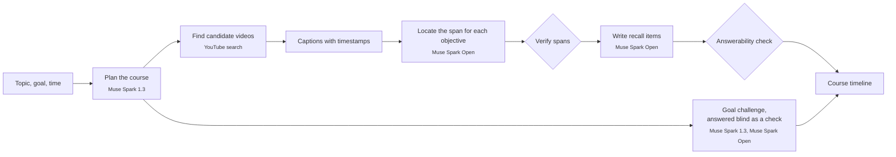
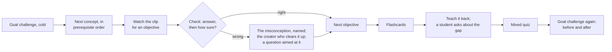

<p align="center">
  <picture>
    <source media="(prefers-color-scheme: dark)" srcset="public/brand/shifu-mark-dark.svg">
    
  </picture>
</p>

<h1 align="center">Shifu</h1>

<p align="center">
  <strong>Any topic, taught by the best moments on YouTube, and checked until it sticks.</strong>
</p>

<p align="center">
  <a href="https://cerebralvalley.ai/e/meta-ai-developer-hackathon"></a>
  
  
  
  
</p>

<br>

Learners already learn from YouTube, but from scattered videos with no structure, no order and no
check that anything stuck. Search ranks videos, not explanations: nothing tells you which ninety
seconds of which video teaches the thing you are missing.

**Shifu** (師父, Mandarin for *master* or *teacher*) turns a topic into a structured course, finds
the moment in a YouTube video that best teaches each learning objective, and plays those clips in
order with recall practice woven in.

<table>
  <tr>
    <td width="50%" valign="top"><strong>A course, not a playlist</strong><br>Modules, concepts and learning objectives in prerequisite order, designed around your goal and the time you have.</td>
    <td width="50%" valign="top"><strong>The right ninety seconds</strong><br>Each objective is matched to the span of a video that teaches it, played through the official YouTube embed.</td>
  </tr>
  <tr>
    <td valign="top"><strong>Your goal, before and after</strong><br>The course opens with your goal as a few scenario questions you take cold, and closes with them again: "Before: 1 of 4. Now: 4 of 4."</td>
    <td valign="top"><strong>Wrong answers that teach</strong><br>Every wrong option stands for a named misconception, and you say how sure you were. A confident mistake marks the objective shaky at once.</td>
  </tr>
  <tr>
    <td valign="top"><strong>Explained differently, at your mistake</strong><br>Miss a question and Shifu plays the other creator whose explanation best clears up the mistake you made, tells you what to watch for, and asks a question aimed at it.</td>
    <td valign="top"><strong>Teach it back</strong><br>Explain the module aloud. A student who listened asks about the gap, and you see what you covered, what you missed and the moment that fills it.</td>
  </tr>
  <tr>
    <td valign="top"><strong>A mind map that fills in</strong><br>Every concept and what it builds on, each ringed by how well you know its objectives, growing as you learn.</td>
    <td valign="top"><strong>A coach that reshapes the course</strong><br>Ask for more questions or the basics behind an idea and the course changes to fit: checked practice comes next, or a new concept is built from fresh clips and grows into your map.</td>
  </tr>
  <tr>
    <td valign="top"><strong>Examples from your world</strong><br>Tell Shifu why you're learning ("for my marketing job") and questions are set in that world where the idea fits.</td>
    <td valign="top"><strong>Progress that means something</strong><br>An objective counts as solid only when you get it right without help and it holds up later, in your own words.</td>
  </tr>
</table>

## How it works



Module 1 is built first, so you can start while the rest builds.

## A learner's path



The coach is there the whole way: ask for more practice, the basics behind an idea, another
explanation, or to skip what you know. Each objective moves from *new* to *learning* to *solid*,
or to *shaky* when it slips. The details are in [`PLAN.md`](PLAN.md) §3 and §7.

## Meta's models at work

| Job | Model | Where |
|---|---|---|
| Design the course: modules, concepts, objectives, the prerequisite graph behind the mind map, and the learner's world | Muse Spark 1.3 | Meta Model API |
| Turn the goal into scenario questions across objectives | Muse Spark 1.3 | Meta Model API |
| Read every candidate video's captions and find the span that teaches each objective | Muse Spark Open | Baseten, then Modal |
| Write check questions, a misconception for every wrong option, and flashcards; answer each question from the clip alone as a check | Muse Spark Open | Baseten, then Modal |
| After a wrong answer, pick the creator who best clears up that mistake and write a question aimed at it | Muse Spark Open | Baseten, then Modal |
| Turn a learner's message to the coach into one change to the course | Muse Spark 1.3 | Meta Model API |
| Transcribe the learner's spoken explanation | Muse Voice Transcribe, with Muse Spark Open listening to the audio as the fallback | Meta Model API, Baseten or Modal |
| Grade the explanation, ask the student's follow-up, and grade the answer | Muse Spark 1.3 | Meta Model API |

Every job falls back to the other Muse Spark model when its provider has no key, is rate-limited or
fails.

## Why you can trust a clip or a question

- **Every span is quoted.** A chosen span carries a quote that must appear in the captions inside the span, or the span is dropped.
- **No clips that start mid-thought.** Spans that lean on earlier context ("as we saw…") are extended back to where that context begins, or marked as not self-contained.
- **Every question is answered blind.** A separate model call answers each question from the clip alone, without the key. Questions it cannot answer correctly, or where another option could also be defended, are thrown away. Goal challenges get the same blind answer.
- **Feedback points at the fix.** Each missing point in a teach-back is tied to an objective and to the clip that explains it, and a "covered" call must quote what the learner actually said.
- **The coach can't invent the course.** Every change it picks is checked against the real objectives and playable concepts, and new questions and concepts go through the same checks as the rest.

## Status

Built in public during the [Meta Global AI Developer Hackathon](https://cerebralvalley.ai/e/meta-ai-developer-hackathon),
27 October to 5 November 2026.

**Working now:** the build pipeline (planning, the goal challenge, span finding with verification,
recall with both checks), the course player with confidence and named misconceptions, "explain it
differently" aimed at the mistake, the voice teach-back with the student's question, the mind map,
the course coach, and the progress tracker. Meta Model API, Baseten and Modal are all live.

**Next:** real course builds and three demo courses (waiting on the captions key), spaced review,
and the live deployment.

- **Progress**, milestone by milestone: [`PROGRESS.md`](PROGRESS.md)
- **The plan**, schedule and risks: [`PLAN.md`](PLAN.md)

## Built during the hackathon

Everything in this repository was written during the hackathon, and the git history starts on
27 October 2026. Shifu is built with Claude Code and Meta's Muse Code. Muse Code's part is a review
of the plan and the spaced-repetition scheduler; this section will list exactly what each tool did
as the work lands.

## Rights and sources

- Clips play through the official YouTube IFrame embed. Shifu never downloads video or audio.
- Captions are used to find and question spans. They are never shown on screen.
- Every clip credits its channel and links to the original video.

## Run it locally

```bash
pnpm install
cp .env.example .env.local   # fill in the keys you have
pnpm dev                     # http://localhost:3000
```

The sample course at `/c/bayes-sample` plays with no keys at all. With a model key (Meta Model
API, Baseten or a Modal endpoint) the teach-back, the coach and "explain it differently" come on;
building a course also needs a SearchAPI key. Without `DATABASE_URL`, courses are stored as files in
`.data/`. `.env.example` lists every variable.

| Command | Does |
|---|---|
| `pnpm test` | unit tests: mastery rules, timeline, router and providers, planning, span and recall checks, goal challenges, the coach, the learner's additions, the mind map layout, transcription, grading, stores |
| `pnpm try:plan "topic"` | plans a real course and prints it |
| `pnpm try:clips` | runs locate → verify → choose → recall on two test transcripts |
| `pnpm try:build ["topic"] [--local]` | the whole build on live models with test video sources |

The API test scripts check each external service on its own:

| Command | Checks |
|---|---|
| `pnpm spike:plan` | Muse Spark 1.3 returns a course plan as schema-checked JSON |
| `pnpm spike:baseten` | Muse Spark Open on Baseten finds a span in a sample transcript |
| `pnpm spike:voice` | Muse Voice Transcribe transcribes a WAV file |
| `pnpm spike:modal` | Muse Spark Open on a Modal endpoint: model names, JSON output, audio input |
| `pnpm spike:youtube` | YouTube search and the embeddable, 3–40 minute filter |

## License

[Apache-2.0](LICENSE)
